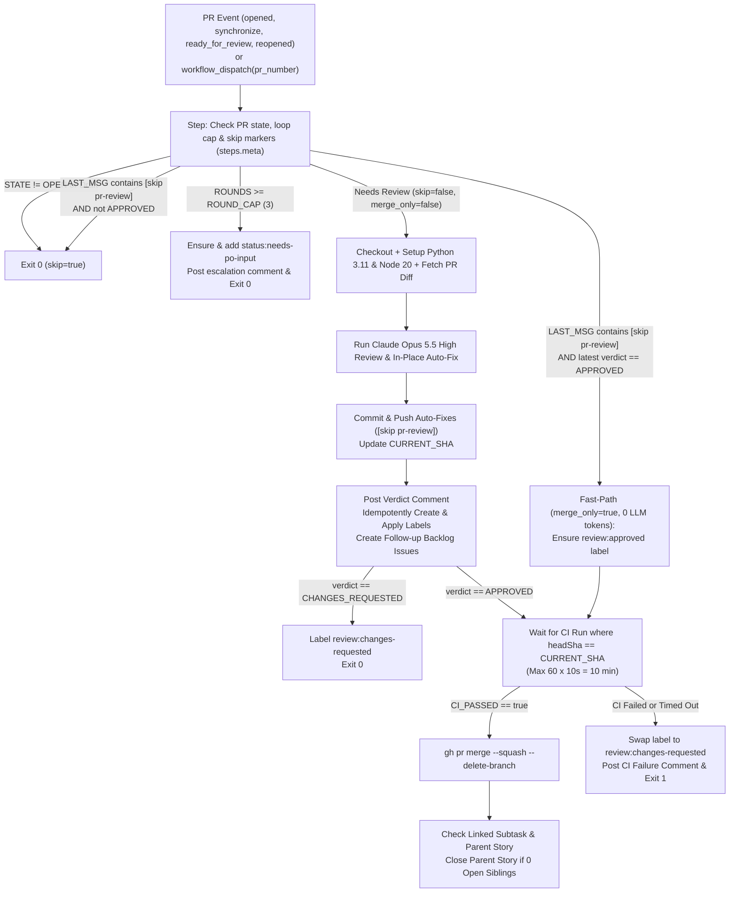

# Fix Automated PR Review Auto-Merge, Self-Cancellation & Label Provisioning Gap

## 1. Problem Statement & Forensic Root Cause Analysis (PR #138)

### 1.1 Incident Summary on PR #138
On [PR #138 (`feat/002-yahoo-finance-workspace`)](https://github.com/AntaresAndBharani/darwin-trader/pull/138), the `PR Review` GitHub Actions workflow ([`.github/workflows/pr-review.yml`](file:///c:/Users/rogal/workspaces/ws-trading/darwin-trader/.github/workflows/pr-review.yml)) was triggered upon PR creation (run `39986836246`, job `120528087270`):
1. **Claude Review & Auto-Fix Succeeded:** Claude Opus 5.5 High executed for ~6m20s, reviewed all changed files, **applied 7 code/test auto-fixes across 10 files (`+198 / -19` lines)**, verified all `270` Python tests and `67` frontend tests passed, and wrote `"verdict": "APPROVED"` to `pr_review_output.json`.
2. **Auto-Fix Commit & Verdict Comment Succeeded:** Step 10 (`Commit auto-fixes, apply verdict, and auto-merge when green`) committed and pushed `32dde4e` (`fix(pr-review): apply Claude Opus 5.5 auto-fixes [skip pr-review]`) to `feat/002-yahoo-finance-workspace` and posted the [review verdict comment](https://github.com/AntaresAndBharani/darwin-trader/pull/138#issuecomment-6369766061).
3. **Auto-Merge Failed:** Immediately after posting the comment, the workflow crashed and was cancelled, leaving PR #138 open and unmerged despite passing CI checks.

### 1.2 Four Compounding Root Causes Identified in `.github/workflows/`
1. **Defect 1 — Missing Repository Labels Crashed `gh pr edit` (`check=True`):**
   - Right after posting the verdict comment, the inline Python script executed:
     ```python
     subprocess.run(['gh', 'pr', 'edit', pr_num, '-R', repo, '--add-label', 'review:approved'], check=True)
     ```
   - Because the labels `review:approved`, `review:changes-requested`, `status:needs-po-input`, `status:ready`, and `status:done` did not exist in `AntaresAndBharani/darwin-trader`, `gh pr edit` exited with code `1` (`'review:approved' not found`), raising `subprocess.CalledProcessError` and aborting the step **before** creating the 4 follow-up backlog issues (`followup_backlog_issues`) or reaching the auto-merge block.
2. **Defect 2 — Self-Cancellation Race Condition via `concurrency: cancel-in-progress: true` & `[skip pr-review]` Dead-End:**
   - Pushing the auto-fix commit (`32dde4e`) using `ORCHESTRATION_PAT` triggered a new `pull_request: [synchronize]` workflow run (`39987806876`) 4 seconds later (`16:33:51Z`).
   - Because `pr-review.yml` defines top-level `concurrency: { group: pr-review-<PR>, cancel-in-progress: true }`, the newly triggered `synchronize` run immediately **cancelled** the original run while it was still executing post-review steps.
   - Then, when the new run (`39987806876`) started `steps.meta`, it saw `[skip pr-review]` in the commit message of `32dde4e` and unconditionally exited (`skip=true`) without merging, stranding the PR in an open state where re-running the workflow also exits as a no-op.
3. **Defect 3 — Unscoped CI Polling, Loop Timeout Fallthrough & Post-Fix CI Failure Stranding:**
   - The CI wait loop queried `gh run list -R "$REPO" -b "$HEAD_REF" -w "CI" -L 1` without filtering by `headSha == CURRENT_SHA`. Immediately after pushing an auto-fix commit, that query can match the *previous* commit's `completed:success` run before the new CI run registers.
   - Additionally, if the `for i in $(seq 1 30)` loop completed all 30 iterations while CI was still `in_progress`, the loop exited normally (`break` was not required) and fell through directly to `gh pr merge` without an explicit `CI_PASSED=true` gate.
   - If CI failed on an `[skip pr-review]` commit, the workflow exited with code `1` while leaving `review:approved` on the PR instead of transitioning the label to `review:changes-requested` and posting a diagnostic comment.
4. **Defect 4 — Duplicate / Racing Workflow Responsibility (`pr-review.yml` vs. `merge.yml`):**
   - Both [`.github/workflows/pr-review.yml`](file:///c:/Users/rogal/workspaces/ws-trading/darwin-trader/.github/workflows/pr-review.yml) and [`.github/workflows/merge.yml`](file:///c:/Users/rogal/workspaces/ws-trading/darwin-trader/.github/workflows/merge.yml) (`on: pull_request: [labeled]` when `review:approved` is added with `ORCHESTRATION_PAT`) attempted to poll CI and execute `gh pr merge`, while only `merge.yml` included the post-merge step to close the parent story once all linked subtasks are complete.

---

## 2. Aligned Design Decisions (`/grill-me` Consensus)

1. **Single-Workflow Consolidation (Retire `merge.yml`):**
   - Consolidate the complete post-review lifecycle (`Review -> Auto-Fix Commit/Push -> Idempotent Label & Follow-up Issue Sync -> Exact-SHA CI Wait -> Squash-Merge -> Parent Story Closure`) inside [`.github/workflows/pr-review.yml`](file:///c:/Users/rogal/workspaces/ws-trading/darwin-trader/.github/workflows/pr-review.yml) and delete [`.github/workflows/merge.yml`](file:///c:/Users/rogal/workspaces/ws-trading/darwin-trader/.github/workflows/merge.yml) so applying `review:approved` never spawns a duplicate/racing workflow run.
2. **Disable Self-Cancellation & Add Zero-Token `merge_only` Fast-Path:**
   - Set `cancel-in-progress: false` on the `pr-review-${{ github.event.pull_request.number || inputs.pr_number }}` concurrency group so a `synchronize` event triggered by pushing an `[skip pr-review]` auto-fix commit queues behind the active run instead of killing it mid-merge.
   - In `steps.meta`, when the latest commit message contains `[skip pr-review]`:
     - Inspect the most recent `<!-- pr-review-verdict -->` comment on the PR.
     - If the PR is `OPEN` and the latest verdict comment is `APPROVED` (e.g., a stranded PR like #138 or a manual `workflow_dispatch` retry), set `skip_review=true` and `merge_only=true`. This skips Python/Node setup and Claude Code invocation (**0 LLM tokens**) and jumps directly to ensuring the `review:approved` label is applied, waiting for CI on `HEAD_SHA`, squash-merging, and checking parent-story closure.
     - If the PR is already closed/merged or the `[skip pr-review]` commit does not have an `APPROVED` verdict, set `skip=true` and exit cleanly.
3. **Self-Healing GitHub Labels (`gh label create --force`):**
   - Provision the required pipeline labels (`review:approved`, `review:changes-requested`, `status:needs-po-input`, `status:ready`, `status:done`, `tech-debt`) in `AntaresAndBharani/darwin-trader`.
   - In `pr-review.yml`, before any `gh pr edit --add-label <label>` or `gh issue create --label <label>` call, idempotently run `gh label create <label> -R "$REPO" --force` (with `check=False` fallback) so missing labels in any repository can never crash the workflow.
4. **Strict `headSha == CURRENT_SHA` CI Verification & Actionable Failure Recovery:**
   - After determining `CURRENT_SHA` (either the newly pushed auto-fix SHA or `steps.meta.outputs.head_sha`), poll `gh run list -R "$REPO" --commit "$CURRENT_SHA" -w "CI"` (up to 60 iterations $\times$ 10s = 10 minutes).
   - Gate `gh pr merge` on an explicit `CI_PASSED="true"` flag.
   - If CI fails (`completed:failure`, `completed:cancelled`, `completed:timed_out`) or does not complete within the 10-minute polling window, automatically remove `review:approved`, ensure and apply `review:changes-requested`, post a diagnostic comment on the PR identifying the failed/timed-out CI run on `CURRENT_SHA`, and exit non-zero.

---

## 3. Target Architecture & Workflow State Machine



---

## 4. Component Impact Table

| File / Resource | Action | Description |
| :--- | :--- | :--- |
| [`.github/workflows/pr-review.yml`](file:///c:/Users/rogal/workspaces/ws-trading/darwin-trader/.github/workflows/pr-review.yml) | **Modify** | Set `cancel-in-progress: false`; add `merge_only` fast-path in `steps.meta`; add idempotent `ensure_label()` helper before `gh pr edit` and `gh issue create`; filter CI polling by `--commit "$CURRENT_SHA"` with explicit `CI_PASSED` gate and `review:changes-requested` fallback on CI failure; append parent-story closing step after merge. |
| [`.github/workflows/merge.yml`](file:///c:/Users/rogal/workspaces/ws-trading/darwin-trader/.github/workflows/merge.yml) | **Delete** | Retire duplicate workflow to prevent double-merge race conditions when `review:approved` is applied with `ORCHESTRATION_PAT`. |
| `CHANGELOG.md` | **Modify** | Document the `pr-review.yml` auto-merge, self-cancellation, exact-SHA CI gating, and label self-healing fix under `## [Unreleased]`. |

---

## 🎯 Final Decision Plan & User Story Specification

### Story Title
`fix(ci): resolve PR Review auto-merge crash, self-cancellation race, and unscoped CI polling`

### Sizing & Pattern Classification
- **Pattern:** **Pattern A (Standalone Task, $\le 300$ LOC, $\le 4$ files)**
- **Files Touched:** 3 files (`.github/workflows/pr-review.yml`, `.github/workflows/merge.yml`, `CHANGELOG.md`)
- **Estimated Diff:** ~140 LOC

### Technical Specification

#### 1. Concurrency Configuration (`.github/workflows/pr-review.yml`)
Change the top-level concurrency block from `cancel-in-progress: true` to `cancel-in-progress: false`:
```yaml
concurrency:
  group: pr-review-${{ github.event.pull_request.number || inputs.pr_number }}
  cancel-in-progress: false
```

#### 2. `steps.meta` — `[skip pr-review]` Inspection & `merge_only` Fast-Path
In `Check PR state, loop cap, and skip markers` (`id: meta`):
- Output `skip=false` and `merge_only=false` by default.
- When `LAST_MSG` contains `"[skip pr-review]"`:
  - Extract the last comment body containing `<!-- pr-review-verdict -->` from `PR_JSON`.
  - If that comment contains `APPROVED` (e.g., `PR Review Verdict: **APPROVED**` or `Verdict: ✅ APPROVED`), output `skip=false` and `merge_only=true` so the job skips checkout/Python/Node/Claude steps and runs the final merge & story-closure steps.
  - Otherwise, output `skip=true` and `merge_only=false` and exit `0`.
- Before applying `status:needs-po-input` on round-cap escalation, ensure the label exists via `gh label create "status:needs-po-input" -R "$REPO" --color "B60205" --force || true`.
- Guard steps `Checkout PR branch` through `Run PR Review & Auto-Fix (Claude Opus 5.5 High)` with:
  ```yaml
  if: steps.meta.outputs.skip != 'true' && steps.meta.outputs.merge_only != 'true'
  ```

#### 3. Self-Healing Labels & Verdict Application Step
In `Commit auto-fixes, apply verdict, and auto-merge when green`:
- Split or structure the post-review execution so that:
  1. **When `merge_only != 'true'` (Full Review Run):**
     - If working tree has changes or `HEAD != INITIAL_SHA`, commit with `"fix(pr-review): apply Claude Opus 5.5 auto-fixes [skip pr-review]"` and push to `origin "HEAD:${HEAD_REF}"`.
     - Record `CURRENT_SHA=$(git rev-parse HEAD)`.
     - Post the `<!-- pr-review-verdict -->` comment.
     - Define a Python helper `ensure_label(repo, name, color, description)` that runs `gh label create <name> -R <repo> --color <color> --description <description> --force` (`check=False`) before applying `review:approved`, `review:changes-requested`, or any label in `followup_backlog_issues`.
     - Create `followup_backlog_issues` **before** any potential failure in downstream steps, and ensure label operations never block follow-up issue creation.
     - Output `verdict` (`APPROVED` or `CHANGES_REQUESTED`) and `current_sha` to `$GITHUB_OUTPUT`.
  2. **When `merge_only == 'true'` (Recovery / Post-Auto-Fix Synchronize Run):**
     - Ensure `review:approved` label exists (`gh label create "review:approved" -R "$REPO" --color "0E8A16" --force || true`) and is applied to the PR (`gh pr edit "$PR_NUMBER" -R "$REPO" --add-label "review:approved" || true`).
     - Set `verdict=APPROVED` and `current_sha=${{ steps.meta.outputs.head_sha }}`.

#### 4. Exact-SHA CI Polling, Auto-Merge & Failure Handling
When `verdict == 'APPROVED'`:
- Poll CI strictly for `CURRENT_SHA` for up to 60 iterations (10 seconds apart, 10 minutes max):
  ```bash
  CI_PASSED="false"
  for i in $(seq 1 60); do
    BUILD_STATUS=$(gh run list -R "$REPO" --commit "$CURRENT_SHA" -w "CI" -L 1 --json status,conclusion -q '.[0] | "\(.status):\(.conclusion)"' || echo "")
    echo "CI status for $CURRENT_SHA ($i/60): ${BUILD_STATUS:-not_registered_yet}"
    if [ "$BUILD_STATUS" = "completed:success" ]; then
      CI_PASSED="true"
      break
    elif [ "$BUILD_STATUS" = "completed:failure" ] || [ "$BUILD_STATUS" = "completed:cancelled" ] || [ "$BUILD_STATUS" = "completed:timed_out" ]; then
      echo "CI failed ($BUILD_STATUS) for commit $CURRENT_SHA."
      break
    fi
    sleep 10
  done
  ```
- If `CI_PASSED != "true"`:
  - Ensure label `review:changes-requested` exists, remove `review:approved`, add `review:changes-requested`, post a diagnostic PR comment explaining that CI did not pass (`$BUILD_STATUS`) on commit `$CURRENT_SHA`, and `exit 1`.
- If `CI_PASSED == "true"`:
  - Check `PR_STATE=$(gh pr view "$PR_NUMBER" -R "$REPO" --json state -q '.state')`.
  - If `PR_STATE == "OPEN"`, execute `gh pr merge "$PR_NUMBER" -R "$REPO" --squash --delete-branch`.
  - Execute the parent-story closure check (migrated from `.github/workflows/merge.yml`), ensuring `status:done` label exists via `gh label create "status:done" -R "$REPO" --color "0E8A16" --force || true` before applying it.

### Gherkin BDD Acceptance Criteria

```gherkin
Feature: Resilient Automated PR Review, Auto-Fix, Exact-SHA CI Verification, and Squash-Merge

  Scenario: PR approved with in-place auto-fixes merges automatically without self-cancellation
    Given an open non-draft Pull Request triggers `.github/workflows/pr-review.yml`
    And repository labels `review:approved` and `review:changes-requested` may or may not exist yet
    When Claude Opus 5.5 High applies auto-fixes in the working tree and outputs `"verdict": "APPROVED"`
    Then the workflow commits and pushes the changes with `[skip pr-review]` and records the new `CURRENT_SHA`
    And the triggered `synchronize` event does not cancel the active workflow run (`cancel-in-progress: false`)
    And the workflow idempotently creates `review:approved` and any follow-up issue labels before applying them
    And the workflow creates all `followup_backlog_issues` listed in `pr_review_output.json`
    And the workflow polls the `CI` workflow strictly matching `--commit "$CURRENT_SHA"` until `completed:success`
    And the workflow squash-merges the PR, deletes the feature branch, and closes the parent story if all sibling subtasks are closed

  Scenario: Stranded or re-dispatched PR with [skip pr-review] and an APPROVED verdict merges with zero LLM tokens
    Given an open Pull Request (such as PR #138) whose `HEAD` commit message contains `[skip pr-review]`
    And the latest `<!-- pr-review-verdict -->` comment on the PR contains `APPROVED`
    When `.github/workflows/pr-review.yml` runs via `synchronize` or `workflow_dispatch`
    Then `steps.meta` sets `merge_only=true` and skips checkout, Python/Node setup, and Claude Code execution (consuming 0 LLM tokens)
    And the workflow ensures the `review:approved` label exists and applies it to the PR
    And the workflow verifies `CI` is `completed:success` for `HEAD_SHA` and squash-merges the PR

  Scenario: CI failure or timeout on the target commit transitions the PR to review:changes-requested
    Given a Pull Request has received `"verdict": "APPROVED"` at `CURRENT_SHA`
    When the `CI` workflow run for `--commit "$CURRENT_SHA"` concludes with `failure`, `cancelled`, or times out after 60 polling attempts
    Then the workflow does not execute `gh pr merge`
    And the workflow removes `review:approved`, ensures and applies `review:changes-requested`, posts a diagnostic failure comment referencing `CURRENT_SHA`, and exits with code 1

  Scenario: Retiring merge.yml prevents duplicate merge executions
    Given `.github/workflows/merge.yml` is removed from the repository
    When `.github/workflows/pr-review.yml` applies the `review:approved` label using `ORCHESTRATION_PAT`
    Then no secondary `Merge & Backlog` workflow is triggered
    And parent story closure is evaluated directly by `pr-review.yml` after squash-merging
```
