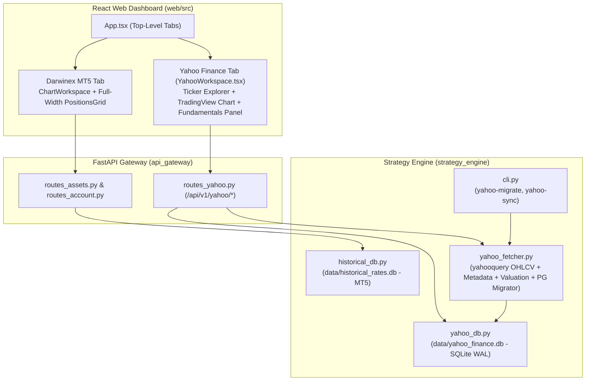

# Yahoo Finance Market Data Integration, PostgreSQL Migration & Web Explorer Workspace

## 1. Problem Statement & Architectural Context

### 1.1 Background & Motivation
Currently, `darwin-trader` sources historical OHLCV market data exclusively from the Darwinex Zero MetaTrader 5 (MT5) CFD bridge into `data/historical_rates.db`. While MT5 is ideal for live CFD account telemetry and position execution, its historical stock feed is limited in depth, lacks global exchange tickers outside Darwinex's CFD universe, and provides no fundamental or valuation metrics.

Across sibling repositories in the workspace ([`stock-manager-cli`](file:///c:/Users/rogal/workspaces/ws-trading/stock-manager-cli/src/tradingtools_stock/core/fetcher.py), [`bl-stock-data-service`](file:///c:/Users/rogal/workspaces/ws-trading/bl-stock-data-service/stock_data_fetcher_function.py), and [`trading-manager`](file:///c:/Users/rogal/workspaces/ws-trading/trading-manager/backend/utils/market_data.py)), we already built a Yahoo Finance (`yahooquery`) pipeline and accumulated a rich dataset in PostgreSQL (`localhost:5433/fractanomicsdb`):
- **`tickers` (1,011 rows):** Exchange/market prefixes (`NASDAQ`, `NYSE`, `BME`, `LSE`, `XETR`, etc.), company names, sectors, industries, and active status.
- **`stock_prices` (1,313,580 rows):** Deep daily OHLCV bars plus historical `quarterly_eps` and `quarterly_revenue`.
- **`valuation_history` (12,374 rows):** Quarterly valuation multiples (`trailing_pe`, `forward_pe`, `pb`, `ps`, `peg`, `ev_ebitda`, `ev_revenue`, `market_cap`, `enterprise_value`, `dividend_yield`).

Additionally, the current Web Dashboard ([`web/src/App.tsx`](file:///c:/Users/rogal/workspaces/ws-trading/darwin-trader/web/src/App.tsx)) renders a placeholder **Strategy Lifecycle** panel ([`web/src/components/StrategySidebar.tsx`](file:///c:/Users/rogal/workspaces/ws-trading/darwin-trader/web/src/components/StrategySidebar.tsx)) hardcoded to `Darwin_Trend_ATR_V1 (EURUSD)` with stubbed `/start`, `/pause`, `/stop` state flags that are unsynchronized with the chart asset and provide no real execution loop.

### 1.2 Design Decisions (Aligned via `/grill-me`)
1. **Data Scope:** Bring over Yahoo Finance daily OHLCV (`stock_prices`), Ticker Metadata (`tickers`: `symbol`, `name`, `market`, `sector`, `industry`, `active`), and Fundamentals & Quarterly Valuation Multiples (`quarterly_eps`, `quarterly_revenue`, and `valuation_history`).
2. **Dedicated Embedded SQLite Storage (`data/yahoo_finance.db`):** Store all Yahoo Finance tables in a dedicated SQLite WAL database (`data/yahoo_finance.db`), keeping `darwin-trader` 100% self-contained without requiring an external PostgreSQL/Docker server, while cleanly isolating Yahoo Finance exchange data from the 3.5 GB MT5 `data/historical_rates.db`.
3. **PostgreSQL Data Migration + Live Yahoo Sync Engine:**
   - Provide a deterministic migration utility/CLI command to migrate all existing `tickers` (1,011), `stock_prices` (1.31M), and `valuation_history` (12.3k) records from `localhost:5433/fractanomicsdb` into `data/yahoo_finance.db`.
   - Port the `yahooquery` fetcher (OHLCV + quarterly EPS/revenue, sector/industry metadata, and valuation history) into `strategy_engine/` and expose it via both `python -m strategy_engine.cli` and FastAPI REST endpoints (`/api/v1/yahoo/...`).
4. **Top-Level Web Dashboard Tabs & StrategySidebar Removal:**
   - Introduce top-level navigation tabs in [`web/src/App.tsx`](file:///c:/Users/rogal/workspaces/ws-trading/darwin-trader/web/src/App.tsx): **`Darwinex MT5`** and **`Yahoo Finance`**.
   - On the **`Darwinex MT5`** tab, remove the placeholder [`StrategySidebar`](file:///c:/Users/rogal/workspaces/ws-trading/darwin-trader/web/src/components/StrategySidebar.tsx) so [`PositionsGrid`](file:///c:/Users/rogal/workspaces/ws-trading/darwin-trader/web/src/components/PositionsGrid.tsx) (Open Positions) spans the full width cleanly.
5. **Master-Detail Yahoo Finance Workspace (`web/src/components/YahooWorkspace.tsx`):**
   - **Ticker Explorer & Management:** Filterable by `Market`, `Sector`, `Industry`, `Active` status, and search query, with controls to add a ticker (`AAPL` or `NASDAQ:AAPL`), toggle active status, or delete a ticker.
   - **TradingView Candlestick & Heikin-Ashi Chart:** Interactive chart supporting `D1`, `W1`, and `MN1` (resampled from daily Yahoo Finance bars) and client-side Heikin-Ashi toggle.
   - **Fundamentals & Quarterly Valuation Panel:** Displays latest valuation multiples (`Trailing P/E`, `Forward P/E`, `P/B`, `P/S`, `PEG`, `EV/EBITDA`, `EV/Revenue`, `Market Cap`, `Enterprise Value`, `Dividend Yield`) and historical quarterly valuation / EPS / revenue records.
   - **Sync & Catch-Up Actions:** Buttons to sync the selected ticker or run a background catch-up sync across active tickers with progress polling.
6. **Client Scope:** Implement in `strategy_engine/`, `api_gateway/`, and `web/` (React Web Dashboard), leaving `tui/` untouched in this phase.

---

## 2. Target Architecture



### 2.1 SQLite Schema (`data/yahoo_finance.db`)
Managed by `YahooFinanceDB` in `strategy_engine/yahoo_db.py` using WAL mode (`PRAGMA journal_mode=WAL;`, `PRAGMA synchronous=NORMAL;`, `PRAGMA busy_timeout=60000;`, `BEGIN IMMEDIATE` retry semantics matching `HistoricalRatesDB`):

```sql
CREATE TABLE IF NOT EXISTS tickers (
    symbol TEXT PRIMARY KEY,
    name TEXT DEFAULT '',
    market TEXT DEFAULT '',
    sector TEXT DEFAULT '',
    industry TEXT DEFAULT '',
    active INTEGER NOT NULL DEFAULT 1,
    created_at TEXT DEFAULT CURRENT_TIMESTAMP
);

CREATE TABLE IF NOT EXISTS stock_prices (
    symbol TEXT NOT NULL,
    date TEXT NOT NULL,           -- ISO YYYY-MM-DD
    open REAL NOT NULL,
    high REAL NOT NULL,
    low REAL NOT NULL,
    close REAL NOT NULL,
    volume INTEGER NOT NULL DEFAULT 0,
    quarterly_eps REAL,
    quarterly_revenue REAL,
    updated_at TEXT DEFAULT CURRENT_TIMESTAMP,
    PRIMARY KEY (symbol, date DESC)
) WITHOUT ROWID;

CREATE TABLE IF NOT EXISTS valuation_history (
    symbol TEXT NOT NULL,
    as_of_date TEXT NOT NULL,     -- ISO YYYY-MM-DD
    period_type TEXT NOT NULL DEFAULT '',
    trailing_pe REAL,
    forward_pe REAL,
    pb REAL,
    ps REAL,
    peg REAL,
    ev_ebitda REAL,
    ev_revenue REAL,
    market_cap REAL,
    enterprise_value REAL,
    dividend_yield REAL,
    updated_at TEXT DEFAULT CURRENT_TIMESTAMP,
    PRIMARY KEY (symbol, as_of_date DESC, period_type)
) WITHOUT ROWID;

CREATE INDEX IF NOT EXISTS idx_tickers_sector_industry ON tickers(sector, industry);
CREATE INDEX IF NOT EXISTS idx_tickers_market ON tickers(market);
```

---

## 🎯 Final Decision Plan & User Story Specification

### User Story
**As a** quantitative trader using Darwin Trader,
**I want** to migrate and synchronize Yahoo Finance stock data (deep daily OHLCV, market/sector/industry metadata, quarterly EPS/revenue, and valuation multiples) into a dedicated local SQLite database (`data/yahoo_finance.db`) and explore it in a dedicated Web Dashboard tab while cleaning up the unused `StrategySidebar` on the Darwinex MT5 tab,
**So that** I can analyze real exchange history and company fundamentals alongside my live Darwinex Zero MT5 account without needing external database servers.

### Component Impact Table

| Layer | File | Action | Description |
| :--- | :--- | :--- | :--- |
| **Strategy Engine** | `strategy_engine/yahoo_db.py` | **CREATE** | SQLite WAL storage layer (`YahooFinanceDB`) for `tickers`, `stock_prices` (with `D1`/`W1`/`MN1` resampling), and `valuation_history`, plus filter/search queries. |
| **Strategy Engine** | `strategy_engine/yahoo_fetcher.py` | **CREATE** | Yahoo Finance (`yahooquery`) fetcher for OHLCV + quarterly EPS/revenue, ticker metadata (`sector`, `industry`, `name`), valuation multiples (`valuation_measures`), and PostgreSQL (`fractanomicsdb`) batch migrator. |
| **Strategy Engine** | `strategy_engine/cli.py` | **MODIFY** | Add `yahoo-migrate` and `yahoo-sync` subcommands to `python -m strategy_engine.cli`. |
| **API Gateway** | `api_gateway/routes_yahoo.py` | **CREATE** | FastAPI router `/api/v1/yahoo` for ticker CRUD/filtering, OHLCV history (`D1`/`W1`/`MN1`), fundamentals & valuation history, single-ticker sync, and background catch-up sync status. |
| **API Gateway** | `api_gateway/main.py` | **MODIFY** | Register `yahoo_router` under `/api/v1/yahoo`. |
| **Web Client** | `web/src/api/yahoo.ts` | **CREATE** | Typed Axios client for `/api/v1/yahoo/*` endpoints. |
| **Web Client** | `web/src/components/YahooWorkspace.tsx` | **CREATE** | Master-Detail Yahoo Finance tab component with filterable ticker list, add/toggle/delete ticker controls, TradingView Candlestick/Heikin-Ashi chart (`D1`/`W1`/`MN1`), fundamentals/valuation panel, and sync controls. |
| **Web Client** | `web/src/App.tsx` | **MODIFY** | Add top-level tabs (`Darwinex MT5` and `Yahoo Finance`) and remove `StrategySidebar` from the `Darwinex MT5` tab so `PositionsGrid` spans full width. |

---

### Gherkin BDD Acceptance Criteria

```gherkin
Feature: Yahoo Finance Storage, Migration, Sync Engine, and Web Explorer Tab

  Scenario 1: Deterministic SQLite WAL storage and timeframe resampling in YahooFinanceDB
    Given an initialized YahooFinanceDB instance backed by "data/yahoo_finance.db"
    When tickers, daily stock_prices (with quarterly_eps and quarterly_revenue), and valuation_history records are upserted
    Then querying tickers supports filtering by market, sector, industry, active status, and case-insensitive search
    And querying price history for "D1", "W1", or "MN1" returns chronologically ordered bars with accurate weekly/monthly OHLCV aggregation
    And querying fundamentals for a symbol returns both the latest valuation snapshot and historical quarterly valuation and earnings series

  Scenario 2: Migration from PostgreSQL fractanomicsdb to SQLite yahoo_finance.db
    Given a PostgreSQL source database with tickers, stock_prices, and valuation_history tables
    When the migration routine `migrate_from_postgres` (or `python -m strategy_engine.cli yahoo-migrate`) is executed
    Then all tickers, stock_prices, and valuation_history rows are batch-copied into `data/yahoo_finance.db` idempotently using upsert semantics
    And the command reports total migrated counts for tickers, price rows, and valuation rows with exit code 0

  Scenario 3: Yahoo Finance Ticker Sync (OHLCV, Metadata, and Valuation Multiples)
    Given a tracked ticker (e.g., "NASDAQ:AAPL" or "BME:SAN") in YahooFinanceDB
    When the Yahoo Finance sync engine fetches updates via `yahooquery`
    Then symbol market suffixes (e.g., ".MC" for BME, ".L" for LSE, ".DE" for XETR) are formatted automatically
    And daily OHLCV bars, quarterly EPS/revenue, sector/industry metadata, and quarterly valuation measures are upserted into `data/yahoo_finance.db`

  Scenario 4: FastAPI /api/v1/yahoo REST Endpoints
    Given the FastAPI Gateway with `routes_yahoo.py` mounted at `/api/v1/yahoo`
    When a client requests `GET /api/v1/yahoo/tickers`, `POST /api/v1/yahoo/tickers`, `PATCH /api/v1/yahoo/tickers/{symbol}`, or `DELETE /api/v1/yahoo/tickers/{symbol}`
    Then tickers and distinct filter facets (markets, sectors, industries) are returned or updated accurately
    And `GET /api/v1/yahoo/tickers/{symbol}/history?timeframe=W1` returns resampled OHLCV bars
    And `GET /api/v1/yahoo/tickers/{symbol}/fundamentals` returns latest valuation metrics, valuation history, and quarterly EPS/revenue history
    And `POST /api/v1/yahoo/sync` triggers single-ticker or background batch catch-up synchronization with status polling at `GET /api/v1/yahoo/sync/status`

  Scenario 5: Top-Level Workspace Tabs and Darwinex MT5 Full-Width Positions Grid
    Given the user opens the Darwin Trader Web Dashboard (`App.tsx`)
    Then top-level navigation tabs "Darwinex MT5" and "Yahoo Finance" are visible
    And on the default "Darwinex MT5" tab, `ChartWorkspace` and a full-width `PositionsGrid` are rendered without the legacy `StrategySidebar`
    When the user clicks the "Yahoo Finance" tab
    Then the `YahooWorkspace` master-detail view is rendered

  Scenario 6: Yahoo Finance Master-Detail Workspace Interaction
    Given the user is on the "Yahoo Finance" tab (`YahooWorkspace.tsx`)
    When the workspace loads
    Then the filterable ticker list, market/sector/industry filter selectors, TradingView candlestick chart (`D1`/`W1`/`MN1` + Heikin-Ashi toggle), and Fundamentals & Valuation panel are displayed
    When the user selects a ticker, changes timeframe, adds a new ticker, or clicks "Sync Ticker" / "Catch-Up All"
    Then the chart and fundamentals panel update reactively with the selected ticker's Yahoo Finance data
```

---

### Functional Slice Breakdown (Strict Sizing Boundary: $\le 4$ files, $\le 300$ LOC per slice)

#### Slice 1: `YahooFinanceDB` SQLite WAL Storage Layer & Resampling Engine
- **Files:**
  - `strategy_engine/yahoo_db.py` (CREATE)
  - `strategy_engine/tests/test_yahoo_db.py` (CREATE)
- **Scope:** Implement `YahooFinanceDB` (`tickers`, `stock_prices`, `valuation_history` tables in SQLite WAL mode), filter/facet queries (`get_tickers`, `get_filter_facets`, `upsert_tickers`, `set_ticker_active`, `delete_ticker`), OHLCV upsert & `D1`/`W1`/`MN1` resampling (`upsert_stock_prices`, `get_price_history`, `get_quarterly_financials`), and valuation history (`upsert_valuation_history`, `get_fundamentals_summary`).

#### Slice 2: Yahoo Finance (`yahooquery`) Fetcher, PostgreSQL Migrator & CLI Commands
- **Files:**
  - `strategy_engine/yahoo_fetcher.py` (CREATE)
  - `strategy_engine/cli.py` (MODIFY)
  - `strategy_engine/tests/test_yahoo_fetcher.py` (CREATE)
- **Scope:** Implement `format_yahoo_ticker` (exchange suffix mapper from `stock-manager-cli`), `fetch_ticker_ohlcv_and_earnings`, `fetch_ticker_metadata`, `fetch_ticker_valuation`, `sync_yahoo_tickers` (with incremental date range detection), and `migrate_postgres_to_sqlite` (batch copying `tickers`, `stock_prices`, `valuation_history` from PostgreSQL into `data/yahoo_finance.db`). Wire `yahoo-migrate` and `yahoo-sync` subcommands into `strategy_engine/cli.py`.

#### Slice 3: FastAPI `/api/v1/yahoo` Gateway Router
- **Files:**
  - `api_gateway/routes_yahoo.py` (CREATE)
  - `api_gateway/main.py` (MODIFY)
  - `api_gateway/tests/test_routes_yahoo.py` (CREATE)
- **Scope:** Expose `GET /api/v1/yahoo/tickers` (with `market`, `sector`, `industry`, `active`, `search` filters + facets), `POST /api/v1/yahoo/tickers`, `PATCH /api/v1/yahoo/tickers/{symbol}`, `DELETE /api/v1/yahoo/tickers/{symbol}`, `GET /api/v1/yahoo/tickers/{symbol}/history`, `GET /api/v1/yahoo/tickers/{symbol}/fundamentals`, `POST /api/v1/yahoo/sync`, and `GET /api/v1/yahoo/sync/status`. Mount router in `api_gateway/main.py`.

#### Slice 4: Web Dashboard Tabs, `StrategySidebar` Removal & `YahooWorkspace` View
- **Files:**
  - `web/src/api/yahoo.ts` (CREATE)
  - `web/src/components/YahooWorkspace.tsx` (CREATE)
  - `web/src/App.tsx` (MODIFY)
  - `web/src/App.test.tsx` & `web/src/components/YahooWorkspace.test.tsx` (MODIFY / CREATE)
- **Scope:** Implement typed `yahooApi` client, create `YahooWorkspace` master-detail component (filterable ticker explorer + add/toggle/delete ticker + TradingView `D1`/`W1`/`MN1` & Heikin-Ashi chart + Fundamentals & Valuation panel + sync buttons), add top-level `Darwinex MT5` / `Yahoo Finance` tabs in `App.tsx`, and remove `StrategySidebar` from the `Darwinex MT5` tab so `PositionsGrid` spans full width.
