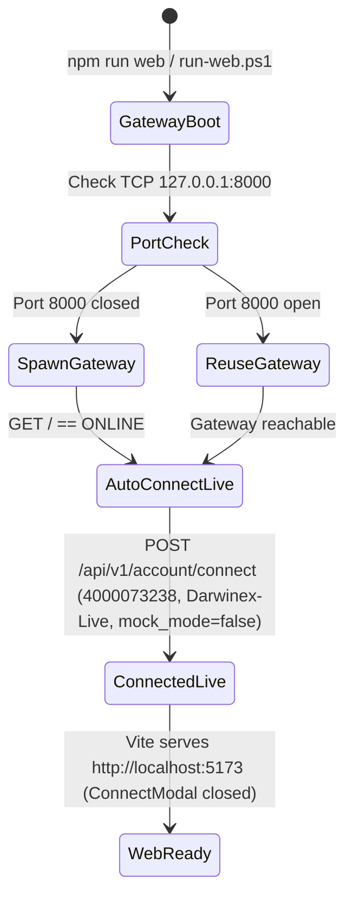

# Phase 1 Data Model: Unified Web & TUI Startup and Connection Parity

**Feature**: `001-web-tui-parity`
**Date**: 2026-10-22

## Entities & Schemas

### 1. `AccountConnectRequest` (Shared REST Payload: Web `web/src/api/account.ts` ↔ Backend `strategy_engine/models.py`)

| Field | Type | Default (Web & TUI Parity) | Validation Rules |
| :--- | :--- | :--- | :--- |
| `login` | `number` | `4000073238` | Required positive integer (`> 0`). |
| `password` | `string` (optional) | `""` (empty string) | Optional. When empty (`""`) and `mock_mode = false`, `MT5Connector.initialize()` attaches directly to the running `terminal64.exe` instance via Win32 IPC without re-authenticating. |
| `server` | `string` | `"Darwinex-Live"` | Selectable from `["Darwinex-Demo", "Darwinex-Live", "MetaQuotes-Demo"]`. Non-empty string. |
| `path` | `string \| null` (optional) | `"C:\\Program Files\\Darwinex MetaTrader 5\\terminal64.exe"` | Optional file system path to `terminal64.exe`. Normalized to `null` if blank so backend falls back to `StrategyConfig.mt5_path`. |
| `mock_mode` | `boolean` | `false` | `false` for live Win32 MT5 IPC; `true` for in-memory Mock Simulation Engine. |

---

### 2. `AccountConnectResponse` (`POST /api/v1/account/connect`)

| Field | Type | Description |
| :--- | :--- | :--- |
| `status` | `'CONNECTED' \| 'DISCONNECTED' \| 'ERROR'` | Resulting connection state after `connector.initialize()`. |
| `message` | `string` | Human-readable status or diagnostic summary. |
| `login` | `number` | Connected MT5 account login ID. |
| `server` | `string` | Connected broker server name. |
| `trade_mode` | `string` | `"REAL"` or `"DEMO"`. |
| `balance` | `number` | Account balance in account currency. |
| `currency` | `string` | Account currency code (e.g., `"USD"`, `"EUR"`). |
| `account_info` | `AccountInfo \| null` | Full account telemetry snapshot when `status === 'CONNECTED'`. |
| `error` | `string \| null` | Formatted MT5 error diagnostic when `status === 'ERROR'`. |

---

### 3. `ConnectModalProps` (`web/src/components/ConnectModal.tsx`)

| Prop | Type | Default | Description |
| :--- | :--- | :--- | :--- |
| `isOpen` | `boolean` | — | Controls modal visibility (`false` on application startup). |
| `onClose` | `() => void` | — | Callback invoked on Cancel, Close (`×`), Escape key, or backdrop click. |
| `onSuccess` | `(res: AccountConnectResponse) => void` | `undefined` | Callback invoked when `POST /api/v1/account/connect` returns `CONNECTED`. |
| `defaultServer` | `string` | `'Darwinex-Live'` | Initial broker server selection. |
| `defaultLogin` | `number \| string` | `4000073238` | Initial MT5 login ID. |
| `defaultPath` | `string` | `'C:\\Program Files\\Darwinex MetaTrader 5\\terminal64.exe'` | Initial MT5 terminal executable path. |
| `defaultMockMode` | `boolean` | `false` | Initial state of the Simulation / Mock Mode checkbox. |

---

### 4. Connection Lifecycle State Transitions

